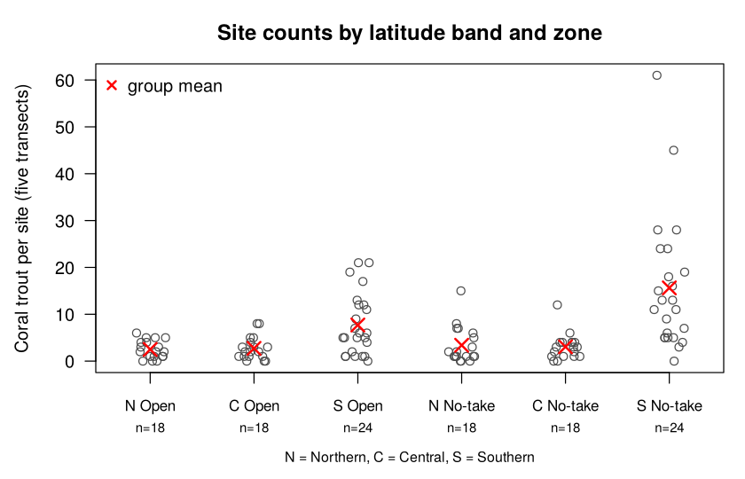

# Coral Trout on the Great Barrier Reef: A GLM Consulting Report

**Question:** Do no-take (protected) reefs hold more coral trout than reefs open to fishing, and does that difference change along the reef?

**Data:** 120 Great Barrier Reef survey sites from 2012 (AIMS Long-Term Monitoring Program).
**Tools:** R, generalised linear models (Poisson, quasi-Poisson, negative binomial), `MASS`, R Markdown.

**[Read the full report →](report.md)**



## Key findings

- **No-take sites hold about 1.76× as many coral trout** as sites open to fishing (95% CI 1.25 to 2.49).
- **Latitude matters most.** Southern sites hold about 3.96× as many as Northern sites (95% CI 2.43 to 6.45). Central and Northern are about the same.
- **The zoning effect is the same across the reef.** There was no evidence it changes with latitude once overdispersion was accounted for (F = 0.87, p = 0.42).
- **The obvious model would have got it wrong.** A plain Poisson model suggested an interaction and gave intervals about 2.3× too narrow. The data's variance is around 5.4× the mean.

## Method

1. **Explore:** group means vs variances showed variance rising far faster than the mean (variance to mean ratios of 1.5 to 12.9).
2. **Fit a Poisson GLM** with latitude band and zone, with and without an interaction.
3. **Check dispersion:** Pearson estimate φ̂ = 5.38, so Poisson standard errors were far too small.
4. **Refit with quasi-Poisson.** The interaction dropped out on an F test. Negative binomial was used as a cross-check and gave the same answers.
5. **Diagnostics:** residuals, leverage and Cook's distance. The most influential site was refitted without it, and no conclusion changed.
6. **Report for a non-technical client:** fitted counts and rate ratios with 95% intervals, plus what the data *can't* say.

## What this analysis can't say

- **Zoning wasn't randomly assigned**, so 1.76× is an association, not a measured effect of protection.
- **It's one year (2012)**, so it says nothing about trends.
- **"No evidence of an interaction" isn't evidence of none.** With this much variability, only a large difference between regions would show up.

## Run it

```r
install.packages(c("MASS", "rmarkdown", "knitr"))
rmarkdown::render("report.Rmd")
```

## Data acknowledgement

Data sourced from the Australian Institute of Marine Science (AIMS): [AIMS Long-Term Monitoring Program, visual census fish dataset](https://apps.aims.gov.au/metadata/view/5be0b340-4ade-11dc-8f56-00008a07204e). The CSV here is a site-level teaching extract (2012 surveys, *Plectropomus* counts summed over five transects, anonymised sites).

---

*Originally written as a consulting-style report for MAST30027 Modern Applied Statistics, University of Melbourne (2026).*
