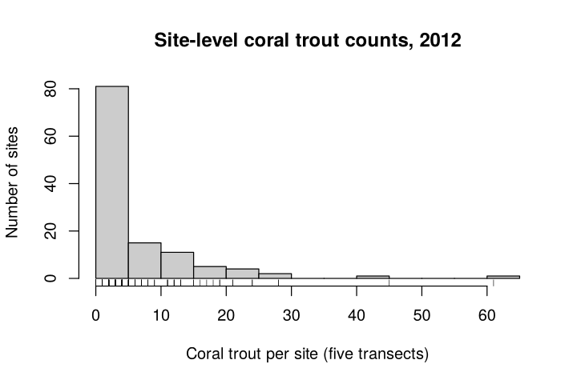
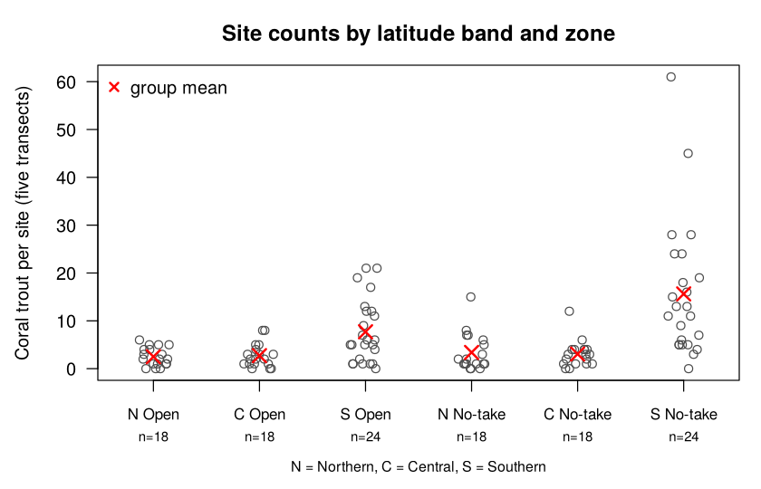
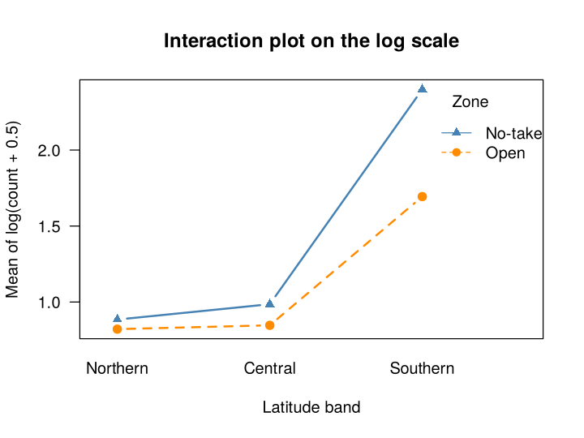
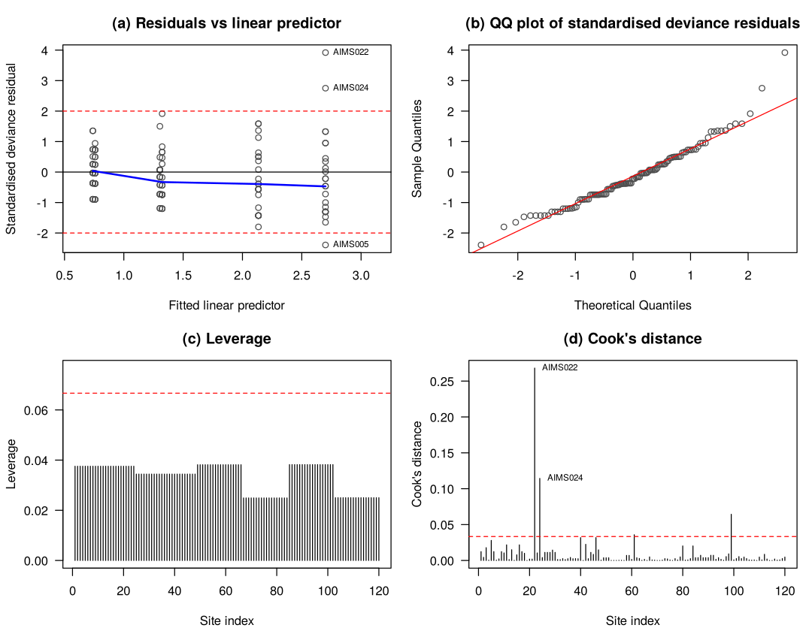

Coral Trout on the Great Barrier Reef: A GLM Consulting Report
================
Michael Vallen Suryajaya

- [1. Executive summary](#1-executive-summary)
- [2. Problem and data](#2-problem-and-data)
- [3. Exploratory analysis](#3-exploratory-analysis)
- [4. Initial GLM: Poisson](#4-initial-glm-poisson)
- [5. Comparing initial models](#5-comparing-initial-models)
- [6. Checking dispersion](#6-checking-dispersion)
- [7. Handling overdispersion and final
  model](#7-handling-overdispersion-and-final-model)
- [8. Diagnostics and alternatives](#8-diagnostics-and-alternatives)
- [9. Estimates and uncertainty](#9-estimates-and-uncertainty)

**Data:** 120 Great Barrier Reef survey sites (2012). A teaching extract
of the AIMS Long-Term Monitoring Program visual census fish dataset:
*Plectropomus* (coral trout) counts summed over five transects per site,
with sites grouped into Northern, Central and Southern latitude bands.
Data sourced from the Australian Institute of Marine Science (AIMS),
[dataset
link](https://apps.aims.gov.au/metadata/view/5be0b340-4ade-11dc-8f56-00008a07204e).

## 1. Executive summary

In 2012, divers are program to surveyed 120 reef sites along the Great
Barrier Reef to count coral trout. The program manager would like to
know how the counts are different among three latitude bands and between
reefs open to fishing and no-take zones, and all this whether due of the
zone difference and the latitude.

Generalised linear model is used to count the data where it’ll assumed
the variance of a count equal to its mean. Since there is data that
violate the assumption, model refitting is then used to allow for extra
variability which widens all reported uncertainty.

Southern sites hold about 4 times as many coral trout as Northern sites.
No-take sites hold about 1.8 times as many coral trout as sites that are
fishing allowed, somewhere between 1.25 and 2.5 times, and the same
multiplier applies in all regions. The analysis only covers a single
year, so it cannot predict whether things are going to get better or
worse.

## 2. Problem and data

Objectives:

- estimate the count for each region and zone
- test whether an interaction is needed
- report the zone comparison with a 95% confidence interval

`coral_trout` = a non-negative integer count with no upper limit that is
recorded once per site

`latitude_band` (Northern, Central, Southern) and `zone` (Open, No-take)
= this is the explanatory variables with Northern and Open as
references, so every number will be compared with a Northern open site.

One row is one site and one count is five equal-length transects added
up. Each site has the same five and totals compare fairly. This is
observational since reefs weren’t randomly assigned their zoning.

``` r
reef <- read.csv("aims_coral_trout_sites_2012.csv")

reef$latitude_band <- factor(
  reef$latitude_band,
  levels = c("Northern", "Central", "Southern")
)
reef$zone <- factor(
  reef$zone,
  levels = c("Open", "No-take")
)

dim(reef)
```

    ## [1] 120   4

``` r
str(reef)
```

    ## 'data.frame':    120 obs. of  4 variables:
    ##  $ site         : chr  "AIMS001" "AIMS002" "AIMS003" "AIMS004" ...
    ##  $ latitude_band: Factor w/ 3 levels "Northern","Central",..: 3 3 3 3 3 3 3 3 3 3 ...
    ##  $ zone         : Factor w/ 2 levels "Open","No-take": 2 2 2 2 2 2 2 2 2 2 ...
    ##  $ coral_trout  : int  5 9 3 13 0 5 13 19 5 24 ...

``` r
colSums(is.na(reef))
```

    ##          site latitude_band          zone   coral_trout 
    ##             0             0             0             0

``` r
sum(duplicated(reef$site))
```

    ## [1] 0

``` r
table(reef$latitude_band, reef$zone)
```

    ##           
    ##            Open No-take
    ##   Northern   18      18
    ##   Central    18      18
    ##   Southern   24      24

Hence it is a balanced design confirming there is 120 rows and 4
columns, no missing values and no repeated site with 18 sites per zone
in the Northern and Central bands and 24 in the Southern.

## 3. Exploratory analysis

``` r
grp <- aggregate(coral_trout ~ latitude_band + zone, data = reef,
                 FUN = function(x) c(n = length(x), mean = mean(x),
                                     var = var(x), median = median(x),
                                     min = min(x), max = max(x)))
grp <- do.call(data.frame, grp)
names(grp) <- c("band", "zone", "n", "mean", "var", "median", "min", "max")
grp$var_mean_ratio <- grp$var / grp$mean
knitr::kable(grp[order(grp$band, grp$zone), ], digits = 2, row.names = FALSE)
```

| band     | zone    |   n |  mean |    var | median | min | max | var_mean_ratio |
|:---------|:--------|----:|------:|-------:|-------:|----:|----:|---------------:|
| Northern | Open    |  18 |  2.50 |   3.79 |    2.0 |   0 |   6 |           1.52 |
| Northern | No-take |  18 |  3.39 |  15.55 |    1.5 |   0 |  15 |           4.59 |
| Central  | Open    |  18 |  2.72 |   6.09 |    2.0 |   0 |   8 |           2.24 |
| Central  | No-take |  18 |  3.06 |   7.70 |    3.0 |   0 |  12 |           2.52 |
| Southern | Open    |  24 |  7.71 |  43.95 |    5.5 |   0 |  21 |           5.70 |
| Southern | No-take |  24 | 15.62 | 201.90 |   12.0 |   0 |  61 |          12.92 |

``` r
hist(reef$coral_trout, breaks = seq(0, 65, by = 5), col = "grey80",
     main = "Site-level coral trout counts, 2012",
     xlab = "Coral trout per site (five transects)", ylab = "Number of sites")
rug(reef$coral_trout)
```

<div class="figure" style="text-align: center">


<p class="caption">
coral trout counts distribution across all 120 sites
</p>

</div>

Figure 1 shows long tail stretching right with counts bunch up near
zero, 13 sites recorded none, one site hit 61. That alone ruled out a
normal linear model as the constant variance from Table 1 contradicts
with group variances rise with group means from 3.8 to 202. But every
variance-to-mean ratio exceeds 1, from 1.5 to 12.9, so the Poisson
equality of mean and variance may be too strict.

``` r
glev <- c("N Open", "C Open", "S Open", "N No-take", "C No-take", "S No-take")
reef$grp <- factor(paste(substr(reef$latitude_band, 1, 1), reef$zone), levels = glev)
set.seed(1)
par(mar = c(5, 4.5, 3, 1))
stripchart(coral_trout ~ grp, data = reef, vertical = TRUE, method = "jitter",
           jitter = 0.15, pch = 1, col = "grey30", las = 1, xaxt = "n",
           xlab = "", ylab = "Coral trout per site (five transects)",
           main = "Site counts by latitude band and zone")
gm <- tapply(reef$coral_trout, reef$grp, mean)
points(seq_along(gm), gm, pch = 4, col = "red", cex = 1.6, lwd = 2)
gn <- table(reef$grp)
axis(1, at = seq_along(gn), labels = glev, las = 1, cex.axis = 0.85)
mtext(paste0("n=", as.vector(gn)), side = 1, at = seq_along(gn), line = 2, cex = 0.75)
mtext("N = Northern, C = Central, S = Southern", side = 1, line = 3.4, cex = 0.8)
legend("topleft", pch = 4, col = "red", pt.lwd = 2, legend = "group mean", bty = "n")
```

<div class="figure" style="text-align: center">


<p class="caption">
Individual site counts within each latitude band and zone
</p>

</div>

``` r
par(mar = c(5.1, 4.1, 4.1, 2.1))
```

Figure 2 shows red crosses mark as group means and sizes then vertical
spread within group is wide, especially in the Southern band (Southern
no-take group holds two high scores at 45 and 61).

``` r
interaction.plot(reef$latitude_band, reef$zone, log(reef$coral_trout + 0.5),
                 fun = mean, type = "b", pch = c(19, 17), col = c("darkorange", "steelblue"),
                 lwd = 2, las = 1, trace.label = "Zone",
                 xlab = "Latitude band", ylab = "Mean of log(count + 0.5)",
                 main = "Interaction plot on the log scale")
```

<div class="figure" style="text-align: center">


<p class="caption">
interaction plot of log group mean counts
</p>

</div>

From Figure 3, it’s shown parallel lines would shows a multiplicative
zone effect across bands and the Southern gap is wider than the two. The
model is additive which means parallel lines have no interaction, but it
shows they are not parallel. Therefore, the no-take zone advantage is
wider in the Southern band.

## 4. Initial GLM: Poisson

**Model:**

Let $Y_i$ be the count at site $i$, $i = 1, \dots, 120$, with
$\mu_i = E(Y_i)$:

$$Y_i \sim \text{Poisson}(\mu_i), \qquad Y_1, \dots, Y_{120} \text{ independent.}$$

Poisson only ever produces whole non-negative numbers with no upper
bound with $\text{Var}(Y_i) = V(\mu_i) = \mu_i$, which is exactly what a
fish count is. Fish behave like events in a fixed sampling window along
the fixed-length transects. Poisson ties spread to average which
variance equals the mean.

**Assumption:**

Sites don’t influence each other, they’re independent and once site’s
region and zone are known, nothing else systematically changes its
count. The equality $\text{Var}(Y_i) = \mu_i$ follows from these.

**Link:**

The canonical log link $g(\mu) = \log \mu$ is used. Since $\eta_i$
ranges over the real line while $\mu_i = e^{\eta_i} > 0$ always, no
coefficients can give a negative or zero fitted mean, which an identity
link cannot guarantee. The log link is also multiplicative, so each
exponentiated coefficient is a rate ratio.

**Linear predictor:**

With Northern and Open as references, let $C_i = 1$ if Central,
$S_i = 1$ if Southern, and $N_i = 1$ if no-take:

$$\log \mu_i = \beta_0 + \beta_1 C_i + \beta_2 S_i + \beta_3 N_i + \beta_4 C_i N_i + \beta_5 S_i N_i.$$

``` r
m1 <- glm(coral_trout ~ latitude_band * zone, family = poisson(link = "log"),
          data = reef)
summary(m1)
```

    ## 
    ## Call:
    ## glm(formula = coral_trout ~ latitude_band * zone, family = poisson(link = "log"), 
    ##     data = reef)
    ## 
    ## Coefficients:
    ##                                   Estimate Std. Error z value Pr(>|z|)    
    ## (Intercept)                        0.91629    0.14907   6.147 7.91e-10 ***
    ## latitude_bandCentral               0.08516    0.20647   0.412   0.6800    
    ## latitude_bandSouthern              1.12601    0.16622   6.774 1.25e-11 ***
    ## zoneNo-take                        0.30421    0.19651   1.548   0.1216    
    ## latitude_bandCentral:zoneNo-take  -0.18870    0.27786  -0.679   0.4971    
    ## latitude_bandSouthern:zoneNo-take  0.40236    0.21607   1.862   0.0626 .  
    ## ---
    ## Signif. codes:  0 '***' 0.001 '**' 0.01 '*' 0.05 '.' 0.1 ' ' 1
    ## 
    ## (Dispersion parameter for poisson family taken to be 1)
    ## 
    ##     Null deviance: 977.60  on 119  degrees of freedom
    ## Residual deviance: 570.62  on 114  degrees of freedom
    ## AIC: 939.3
    ## 
    ## Number of Fisher Scoring iterations: 5

``` r
# rate ratios: exponentiated coefficients
knitr::kable(data.frame(term = names(coef(m1)),
                        estimate = round(coef(m1), 4),
                        rate_ratio = round(exp(coef(m1)), 3)),
             row.names = FALSE,
             caption = "Interaction-model coefficients and their rate ratios.")
```

| term                              | estimate | rate_ratio |
|:----------------------------------|---------:|-----------:|
| (Intercept)                       |   0.9163 |      2.500 |
| latitude_bandCentral              |   0.0852 |      1.089 |
| latitude_bandSouthern             |   1.1260 |      3.083 |
| zoneNo-take                       |   0.3042 |      1.356 |
| latitude_bandCentral:zoneNo-take  |  -0.1887 |      0.828 |
| latitude_bandSouthern:zoneNo-take |   0.4024 |      1.495 |

Interaction-model coefficients and their rate ratios.

**Coefficients.** $\hat\beta_0 = 0.916$ is the log expected count at a
Northern open site, which therefore holds $e^{0.916} = 2.5$ fish. The
rest are log rate ratios: $\hat\beta_1 = 0.085$ gives $1.09$ and
$\hat\beta_2 = 1.126$ gives $3.08$, so Central and Southern open sites
hold 9% and about three times more. $\hat\beta_3 = 0.304$ gives $1.36$,
the no-take-to-open ratio in the Northern band alone; the interactions
change it to $e^{\beta_3 + \beta_4} = 1.12$ in the Central band and
$e^{\beta_3 + \beta_5} = 2.03$ in the Southern. No single coefficient
therefore answers the client’s zone question.

## 5. Comparing initial models

$$\log \mu_i = \beta_0 + \beta_1 C_i + \beta_2 S_i + \beta_3 N_i.$$

Since it is nested, so $H_0: \beta_4 = \beta_5 = 0$ is tested at the 5%
level by difference in deviance and it’s referred to a chi-squared
distribution.

``` r
m0 <- glm(coral_trout ~ latitude_band + zone, family = poisson(link = "log"),
          data = reef)
anova(m0, m1, test = "Chisq")
```

    ## Analysis of Deviance Table
    ## 
    ## Model 1: coral_trout ~ latitude_band + zone
    ## Model 2: coral_trout ~ latitude_band * zone
    ##   Resid. Df Resid. Dev Df Deviance Pr(>Chi)   
    ## 1       116     580.03                        
    ## 2       114     570.62  2   9.4029 0.009082 **
    ## ---
    ## Signif. codes:  0 '***' 0.001 '**' 0.01 '*' 0.05 '.' 0.1 ' ' 1

``` r
AIC(m0, m1)
```

    ##    df      AIC
    ## m0  4 944.7003
    ## m1  6 939.2974

The result shows the deviance drops by 9.4 on 2 degrees of freedom with
$p = 0.009$. AIC also valid since Poisson has a genuine likelihood and
also prefers the interaction model (939.3 vs 944.7).

Both criteria rest on $\text{Var}(Y_i) = \mu_i$. If the true variance
exceeds the mean, the deviance difference is inflated and the p-value
too small, flagging an interaction the data do not support, a risk the
ratios in Table 1 already suggest.

## 6. Checking dispersion

The dispersion is estimated from the Pearson residuals of the
interaction model. With $r_i^P = (y_i - \hat\mu_i)/\sqrt{\hat\mu_i}$,

$$\hat\phi = \frac{X^2}{n - p} = \frac{1}{n-p}\sum_{i=1}^{n} \frac{(y_i - \hat\mu_i)^2}{\hat\mu_i},$$

with $n - p = 120 - 6 = 114$ residual degrees of freedom.

``` r
pear <- residuals(m1, type = "pearson")
X2 <- sum(pear^2)
dfres <- df.residual(m1)
round(c(X2 = X2, df = dfres, phi_hat = X2 / dfres), 3)
```

    ##      X2      df phi_hat 
    ## 613.043 114.000   5.378

``` r
# Goodness of fit: both statistics against chi-squared on 114 df
gof <- data.frame(
  statistic = c("Residual deviance", "Pearson X^2"),
  value     = round(c(deviance(m1), X2), 2),
  df        = dfres,
  p_value   = signif(c(pchisq(deviance(m1), dfres, lower.tail = FALSE),
                       pchisq(X2, dfres, lower.tail = FALSE)), 3)
)
knitr::kable(gof, row.names = FALSE,
             caption = "Goodness-of-fit statistics for the Poisson interaction model.")
```

| statistic         |  value |  df | p_value |
|:------------------|-------:|----:|--------:|
| Residual deviance | 570.62 | 114 |       0 |
| Pearson X^2       | 613.04 | 114 |       0 |

Goodness-of-fit statistics for the Poisson interaction model.

The Pearson dispersion estimate is
$\hat\phi = X^2/(n-p) = 613.0/114 = 5.38$. If Poisson were right this
should sit near 1, but it’s over five times that. Goodness of fit agrees
where the residual deviance is 570.6 on 114 degrees of freedom,
$p < 10^{-5}$ against $\chi^2_{114}$ and the Pearson statistic gives the
same verdict which both should land near 114 if the model fits. These
chi-squared approximations get rough when fitted means are small and
results sit near 2, but a ratio of 5.4 is far too large to blame on
that.

With two factors and their interaction, the model already reproduces all
six group averages exactly, so no rearrangement of the predictors can
reduce the leftover variation. Poisson standard errors are too small
(2.32). Every z-statistic is inflated by that same factor, so Section 5
test rejected far too easily and its decision can’t stand.

## 7. Handling overdispersion and final model

``` r
q1 <- glm(coral_trout ~ latitude_band * zone, family = quasipoisson(link = "log"),
          data = reef)
q0 <- glm(coral_trout ~ latitude_band + zone, family = quasipoisson(link = "log"),
          data = reef)
summary(q1)
```

    ## 
    ## Call:
    ## glm(formula = coral_trout ~ latitude_band * zone, family = quasipoisson(link = "log"), 
    ##     data = reef)
    ## 
    ## Coefficients:
    ##                                   Estimate Std. Error t value Pr(>|t|)   
    ## (Intercept)                        0.91629    0.34569   2.651  0.00918 **
    ## latitude_bandCentral               0.08516    0.47880   0.178  0.85915   
    ## latitude_bandSouthern              1.12601    0.38545   2.921  0.00420 **
    ## zoneNo-take                        0.30421    0.45569   0.668  0.50575   
    ## latitude_bandCentral:zoneNo-take  -0.18870    0.64434  -0.293  0.77017   
    ## latitude_bandSouthern:zoneNo-take  0.40236    0.50106   0.803  0.42364   
    ## ---
    ## Signif. codes:  0 '***' 0.001 '**' 0.01 '*' 0.05 '.' 0.1 ' ' 1
    ## 
    ## (Dispersion parameter for quasipoisson family taken to be 5.377587)
    ## 
    ##     Null deviance: 977.60  on 119  degrees of freedom
    ## Residual deviance: 570.62  on 114  degrees of freedom
    ## AIC: NA
    ## 
    ## Number of Fisher Scoring iterations: 5

``` r
anova(q0, q1, test = "F")
```

    ## Analysis of Deviance Table
    ## 
    ## Model 1: coral_trout ~ latitude_band + zone
    ## Model 2: coral_trout ~ latitude_band * zone
    ##   Resid. Df Resid. Dev Df Deviance      F Pr(>F)
    ## 1       116     580.03                          
    ## 2       114     570.62  2   9.4029 0.8743 0.4199

**Valid tools:**

Quasi-likelihood has no full likelihood, so AIC is undefined and R
prints `AIC: NA`, and the likelihood ratio and chi-squared deviance
tests are unavailable for the same reason. The F test is the valid
comparison for nested quasi-likelihood models.

Testing $H_0: \beta_4 = \beta_5 = 0$ gives $F = 0.874$ on 2 and 114
degrees of freedom, $p = 0.42$. Therefore interaction in Section 5 was
the result of the Poisson variance assumption.

``` r
library(MASS)
nb1 <- glm.nb(coral_trout ~ latitude_band * zone, data = reef)
nb0 <- glm.nb(coral_trout ~ latitude_band + zone, data = reef)
anova(nb0, nb1)
```

    ## Likelihood ratio tests of Negative Binomial Models
    ## 
    ## Response: coral_trout
    ##                  Model    theta Resid. df    2 x log-lik.   Test    df LR stat.
    ## 1 latitude_band + zone 1.584412       116       -644.8148                      
    ## 2 latitude_band * zone 1.628190       114       -642.4864 1 vs 2     2 2.328354
    ##     Pr(Chi)
    ## 1          
    ## 2 0.3121795

``` r
round(c(AIC_nb_additive = AIC(nb0), AIC_nb_interaction = AIC(nb1),
        theta = nb0$theta), 2)
```

    ##    AIC_nb_additive AIC_nb_interaction              theta 
    ##             654.81             656.49               1.58

By assuming $\text{Var}(Y_i) = \mu_i + \mu_i^2/\theta$, negative
binomial cross-check has a genuine likelihood, so the likelihood ratio
test and AIC both agree that interaction gives $p = 0.31$ and AIC
prefers additive model (654.8 vs 656.5).

Hence the final model is selected by using quasi-Poisson additive model,
$$\log \mu_i = \beta_0 + \beta_1 C_i + \beta_2 S_i + \beta_3 N_i, \qquad \text{Var}(Y_i) = \phi\mu_i,$$
with $\hat\phi = 5.40$, preferred to the negative binomial because it
assumes only a mean and a variance function.

``` r
qf <- glm(coral_trout ~ latitude_band + zone, family = quasipoisson(link = "log"),
          data = reef)
summary(qf)
```

    ## 
    ## Call:
    ## glm(formula = coral_trout ~ latitude_band + zone, family = quasipoisson(link = "log"), 
    ##     data = reef)
    ## 
    ## Coefficients:
    ##                       Estimate Std. Error t value Pr(>|t|)    
    ## (Intercept)            0.75789    0.25166   3.012  0.00319 ** 
    ## latitude_bandCentral  -0.01905    0.32085  -0.059  0.95276    
    ## latitude_bandSouthern  1.37682    0.24624   5.591 1.52e-07 ***
    ## zoneNo-take            0.56523    0.17429   3.243  0.00154 ** 
    ## ---
    ## Signif. codes:  0 '***' 0.001 '**' 0.01 '*' 0.05 '.' 0.1 ' ' 1
    ## 
    ## (Dispersion parameter for quasipoisson family taken to be 5.404279)
    ## 
    ##     Null deviance: 977.60  on 119  degrees of freedom
    ## Residual deviance: 580.03  on 116  degrees of freedom
    ## AIC: NA
    ## 
    ## Number of Fisher Scoring iterations: 5

## 8. Diagnostics and alternatives

``` r
rstd <- rstandard(qf, type = "deviance")
hlev <- hatvalues(qf)
cook <- cooks.distance(qf)
flag <- abs(rstd) > 2

par(mfrow = c(2, 2), mar = c(4.2, 4.2, 3, 1))

etahat <- predict(qf, type = "link")
plot(etahat, rstd, pch = 1, col = "grey30", las = 1,
     xlim = range(etahat) + c(-0.15, 0.45),
     xlab = "Fitted linear predictor", ylab = "Standardised deviance residual",
     main = "(a) Residuals vs linear predictor")
abline(h = c(-2, 0, 2), lty = c(2, 1, 2), col = c("red", "black", "red"))
lines(lowess(etahat, rstd), col = "blue", lwd = 2)
text(etahat[flag], rstd[flag], reef$site[flag], pos = 4, cex = 0.7)

qqnorm(rstd, main = "(b) QQ plot of standardised deviance residuals", las = 1,
       pch = 1, col = "grey30")
qqline(rstd, col = "red")

plot(hlev, type = "h", las = 1, xlab = "Site index", ylab = "Leverage",
     main = "(c) Leverage", ylim = c(0, max(hlev, 2 * mean(hlev)) * 1.15))
abline(h = 2 * mean(hlev), col = "red", lty = 2)

plot(cook, type = "h", las = 1, xlab = "Site index", ylab = "Cook's distance",
     main = "(d) Cook's distance")
abline(h = 4 / nrow(reef), col = "red", lty = 2)
text(which(cook > 0.1), cook[cook > 0.1], reef$site[cook > 0.1], pos = 4, cex = 0.7)
```

<div class="figure" style="text-align: center">


<p class="caption">
Diagnostic for the final quasi-Poisson additive model.
</p>

</div>

``` r
par(mfrow = c(1, 1))
```

``` r
diagtab <- data.frame(site = reef$site, band = reef$latitude_band, zone = reef$zone,
                      count = reef$coral_trout, fitted = round(fitted(qf), 2),
                      rstd = round(rstd, 2), leverage = round(hlev, 3),
                      cooks = round(cook, 3))
knitr::kable(diagtab[order(-abs(diagtab$rstd)), ][1:5, ], row.names = FALSE)
```

| site    | band     | zone    | count | fitted |  rstd | leverage | cooks |
|:--------|:---------|:--------|------:|-------:|------:|---------:|------:|
| AIMS022 | Southern | No-take |    61 |  14.88 |  3.92 |    0.038 | 0.268 |
| AIMS024 | Southern | No-take |    45 |  14.88 |  2.75 |    0.038 | 0.114 |
| AIMS005 | Southern | No-take |     0 |  14.88 | -2.39 |    0.038 | 0.028 |
| AIMS099 | Northern | No-take |    15 |   3.76 |  1.91 |    0.038 | 0.064 |
| AIMS029 | Southern | Open    |     0 |   8.45 | -1.80 |    0.034 | 0.014 |

``` r
round(c(max_leverage = max(hlev),
        cutoff_2p_n = 2 * length(coef(qf)) / nrow(reef),
        max_cooks = max(cook), cutoff_4_n = 4 / nrow(reef)), 4)
```

    ## max_leverage  cutoff_2p_n    max_cooks   cutoff_4_n 
    ##       0.0382       0.0667       0.2681       0.0333

Based on panel (a) from Figure 4 shows no curvature and no funnel which
means log link and additive structure fit nicely. With 3 sites exceed
$|r| = 2$ which all is from Southern no-take zone (AIMS022 at 3.92,
AIMS024 at 2.75 and AIMS005 at $-2.39$), all listed in Table 2. With 120
sites, it is expected roughly 5 to land outside $\pm 2$ by chance alone,
so three is fewer than expected. The max leverage is 0.038 which is
against the cutoff of $2p/n = 0.067$, so nothing is flagged and no site
sits anywhere unusual. Two of largest Cook’s distance flags (AIMS022 at
0.268 and AIMS024 at 0.114) also exceed the $4/n = 0.033$ screen, but
sit far below 1.

``` r
reef_no22 <- reef[reef$site != "AIMS022", ]
qf2 <- glm(coral_trout ~ latitude_band + zone, family = quasipoisson(link = "log"),
           data = reef_no22)
q2i <- glm(coral_trout ~ latitude_band * zone, family = quasipoisson(link = "log"),
           data = reef_no22)
round(summary(qf2)$coefficients, 4)
```

    ##                       Estimate Std. Error t value Pr(>|t|)
    ## (Intercept)             0.8221     0.2259  3.6397   0.0004
    ## latitude_bandCentral   -0.0190     0.2887 -0.0660   0.9475
    ## latitude_bandSouthern   1.2874     0.2237  5.7543   0.0000
    ## zoneNo-take             0.4626     0.1608  2.8763   0.0048

``` r
round(c(phi_full = summary(qf)$dispersion,
        phi_dropped = summary(qf2)$dispersion,
        RR_zone_full = exp(coef(qf)[["zoneNo-take"]]),
        RR_zone_dropped = exp(coef(qf2)[["zoneNo-take"]])), 3)
```

    ##        phi_full     phi_dropped    RR_zone_full RR_zone_dropped 
    ##           5.404           4.376           1.760           1.588

``` r
anova(qf2, q2i, test = "F")
```

    ## Analysis of Deviance Table
    ## 
    ## Model 1: coral_trout ~ latitude_band + zone
    ## Model 2: coral_trout ~ latitude_band * zone
    ##   Resid. Df Resid. Dev Df Deviance      F Pr(>F)
    ## 1       115     494.35                          
    ## 2       113     489.22  2   5.1251 0.5807 0.5611

Refitting without AIMS022 moves the no-take rate ratio from 1.76 to
1.59, still significant ($p = 0.005$), the interaction still
non-significant ($F = 0.58$, $p = 0.56$) and dispersion falling from
5.40 to 4.38, so the site contributes to the overdispersion without
creating it. No substantive conclusion changes, so it is retained;
dropping high counts would bias the means downward.

**Alternatives:**

If use negative binomial, it’ll give the same answers, and its $\theta$
of 1.58 predicts about 16 expected zeros against 13 (observed), so there
is no zero-inflation problem. Better recommendation is need more
information such as reef identity, habitat, reef-level etc, which would
explain more detail instead of just absorbing it into $\phi$.

## 9. Estimates and uncertainty

``` r
newd <- expand.grid(latitude_band = levels(reef$latitude_band),
                    zone = levels(reef$zone))
pr <- predict(qf, newdata = newd, type = "link", se.fit = TRUE)
tcrit <- qt(0.975, df = df.residual(qf))

fittab <- data.frame(
  band = newd$latitude_band, zone = newd$zone,
  eta = round(pr$fit, 3), se_eta = round(pr$se.fit, 3),
  fitted_count = round(exp(pr$fit), 2),
  lower = round(exp(pr$fit - tcrit * pr$se.fit), 2),
  upper = round(exp(pr$fit + tcrit * pr$se.fit), 2)
)
knitr::kable(fittab[order(fittab$band, fittab$zone), ], row.names = FALSE)
```

| band     | zone    |   eta | se_eta | fitted_count | lower | upper |
|:---------|:--------|------:|-------:|-------------:|------:|------:|
| Northern | Open    | 0.758 |  0.252 |         2.13 |  1.30 |  3.51 |
| Northern | No-take | 1.323 |  0.234 |         3.76 |  2.36 |  5.97 |
| Central  | Open    | 0.739 |  0.254 |         2.09 |  1.27 |  3.46 |
| Central  | No-take | 1.304 |  0.237 |         3.68 |  2.31 |  5.89 |
| Southern | Open    | 2.135 |  0.148 |         8.45 |  6.30 | 11.34 |
| Southern | No-take | 2.700 |  0.117 |        14.88 | 11.81 | 18.75 |

``` r
cf <- summary(qf)$coefficients
b_zone <- cf["zoneNo-take", "Estimate"]
se_zone <- cf["zoneNo-take", "Std. Error"]

# 95% CI on the linear predictor (log) scale
ci_link <- b_zone + c(-1, 1) * tcrit * se_zone
round(c(estimate_log = b_zone, se = se_zone,
        lower_log = ci_link[1], upper_log = ci_link[2]), 4)
```

    ## estimate_log           se    lower_log    upper_log 
    ##       0.5652       0.1743       0.2200       0.9104

``` r
# back-transformed to a rate ratio on the response scale
round(c(rate_ratio = exp(b_zone), lower = exp(ci_link[1]),
        upper = exp(ci_link[2])), 3)
```

    ## rate_ratio      lower      upper 
    ##      1.760      1.246      2.485

``` r
# latitude band contrasts, both relative to Northern
for (nm in c("latitude_bandCentral", "latitude_bandSouthern")) {
  est <- cf[nm, "Estimate"]; se <- cf[nm, "Std. Error"]
  print(round(c(RR = exp(est), lower = exp(est - tcrit * se),
                upper = exp(est + tcrit * se)), 3))
}
```

    ##    RR lower upper 
    ## 0.981 0.520 1.852 
    ##    RR lower upper 
    ## 3.962 2.433 6.453

Table 3 gives the fitted site means: about 2.1 fish at Northern and
Central open sites, 8.5 at Southern open and 14.9 at Southern no-take,
with wide intervals throughout.

**Zoning comparison:**

$\hat\beta_3 = 0.5652$ on the linear predictor scale, standard error
0.1743, on 116 residual degrees of freedom.

$$\hat\beta_3 \pm t_{0.975,116} \times \text{SE} = 0.5652 \pm 1.9806 \times 0.1743 = (0.220,\ 0.910).$$

Exponentiating both endpoints, valid because the exponential is
monotonic:

$$e^{0.5652} = 1.76, \qquad \text{95\% CI } (1.25,\ 2.49).$$

In words, these no-take sites hold about 1.76 times as many coral trout
as open sites (1.25 to 2.49). The naive Poisson fit would have reported
1.52 to 2.04 which the interval is 2.3 times too narrow.

In conclusion, latitude is mainly the reason where Southern sites hold
3.96 times as many as Northern (95% CI 2.43 to 6.45), while Central sits
at 0.98 times Northern with an interval of 0.52 to 1.85, that
comfortably contains 1. The no-take zone is also 1.76 times more applied
in all three bands, no evidence after accounting for overdispersion that
it varied with latitude ($F = 0.87$, $p = 0.42$).

Three conclusions to avoid. Zoning was not assigned, so 1.76 is not a
measured effect of protection: no-take reefs may differ in habitat,
remoteness or pre-existing abundance. The analysis covers 2012 alone and
says nothing about trend. And no evidence of an interaction is not
evidence of none, since with this much variability only a large
difference between bands was detectable.

**Software.** R (R Core Team) with the base `stats` package and `MASS`
(Venables and Ripley) for the negative binomial cross-check in Section
7.
